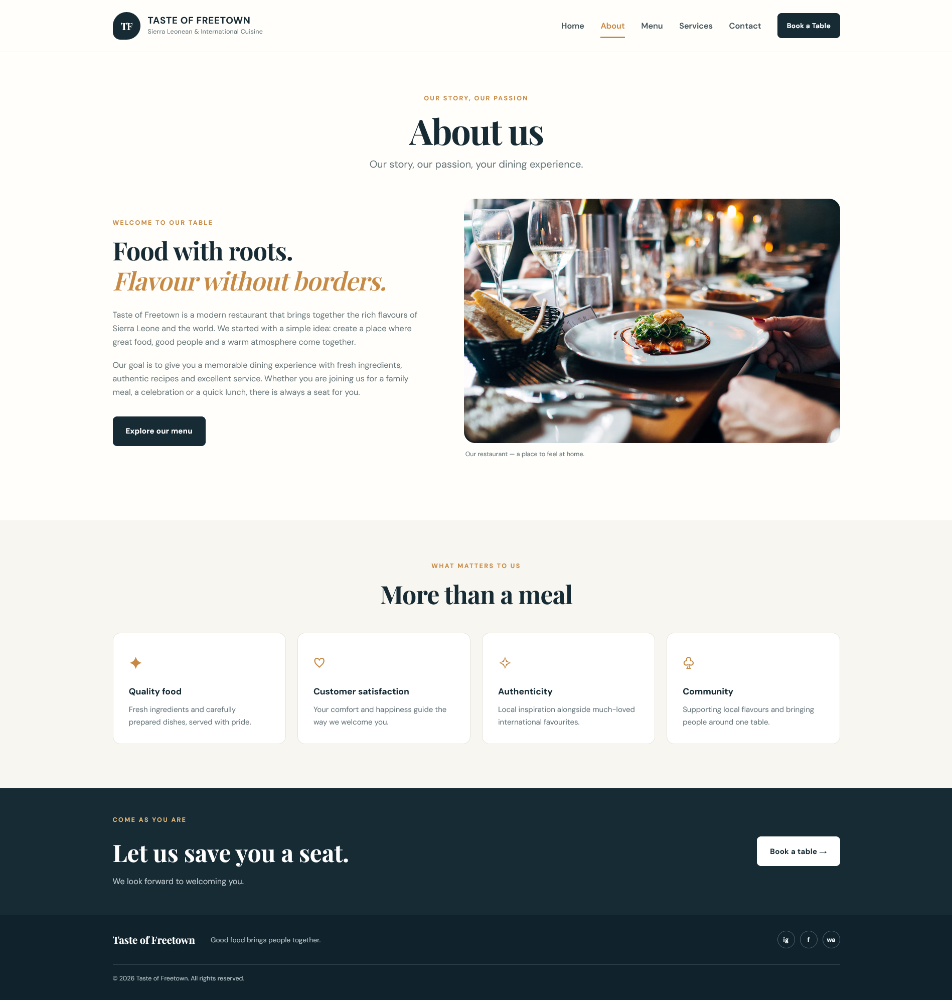
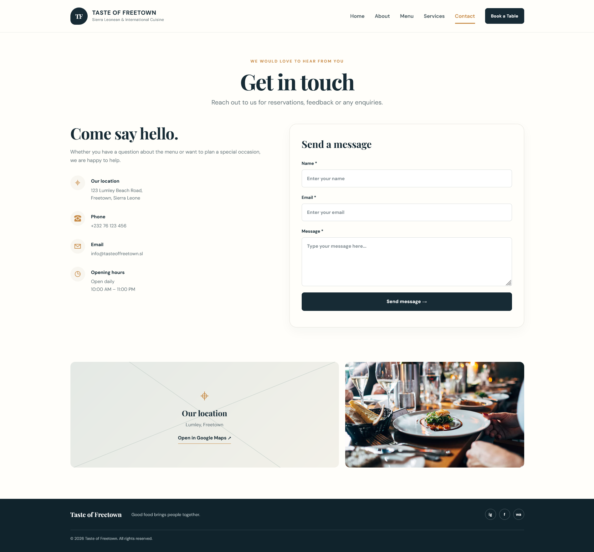
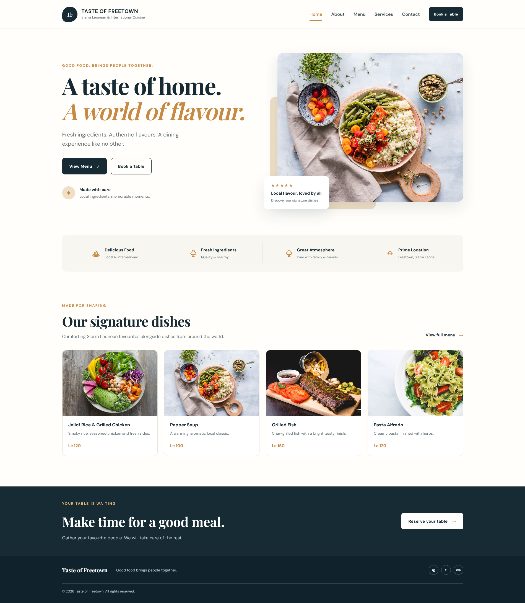
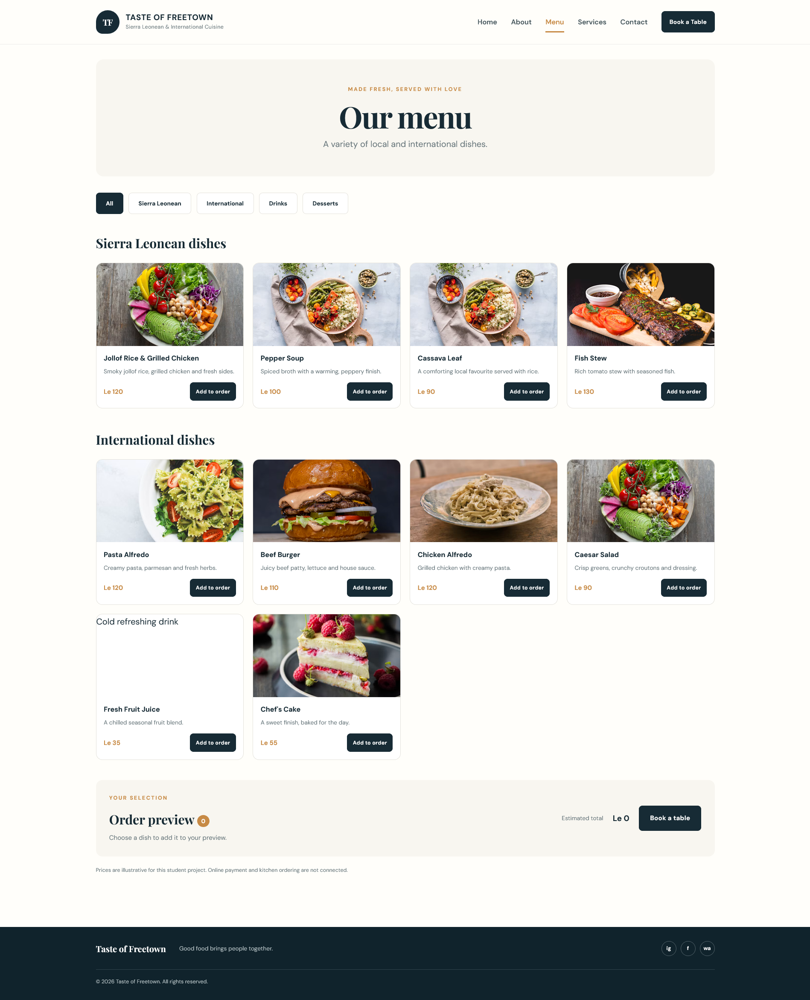
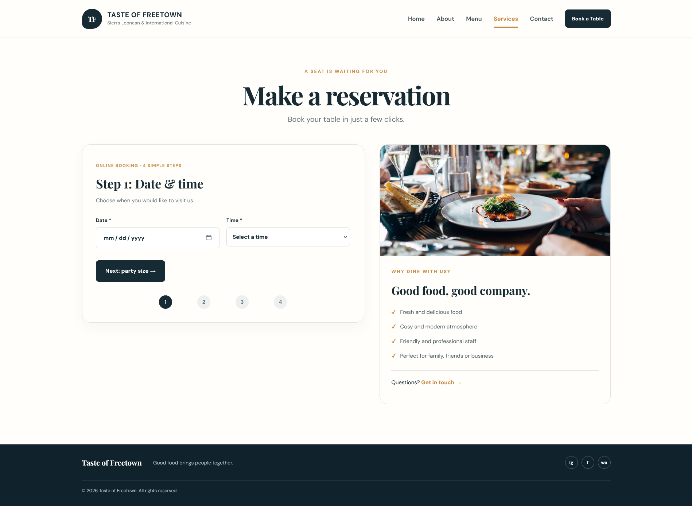

# Taste of Freetown — Responsive Multi-Page Website
    
A front-end implementation of the supplied Taste of Freetown wireframe for DCOMP 204 Web Design, Assignment 2. It uses semantic HTML, one shared stylesheet and one shared JavaScript file.

## Pages and wireframe mapping

1. **Home (`index.html`)** — brand header and navigation, hero image and call-to-action buttons, four service highlights, signature dishes, reservation banner and footer.
2. **About (`about.html`)** — story section, restaurant image, values cards and booking call-to-action.
3. **Menu (`menu.html`)** — category filters (All, Sierra Leonean, International, Drinks and Desserts), food cards with Le prices, add-to-order buttons and a live order preview.
4. **Services / Reservation (`reservation.html`)** — four-step booking flow: date and time, party size and special requests, guest contact details, and confirmation.
5. **Contact (`contact.html`)** — contact details, message form and location panel with a Google Maps link.

## Requirements addressed

- **Minimum five pages:** five separate HTML pages are included.
- **Responsive layout:** media queries support desktop, tablet and mobile layouts.
- **Design fidelity:** dark navy branding, warm gold accents, food photography, card layouts, clear calls to action and the booking sequence follow the supplied wireframe.
- **Semantic and accessible HTML:** page landmarks, labelled form fields, image alternative text, keyboard skip link, navigation labels, visible focus states and reduced-motion support.
- **JavaScript interactions:** responsive navigation, menu filtering, order preview, required-field validation, multi-step reservation and contact-form feedback.
- **Consistent architecture:** shared CSS and JS prevent repeated code and make the site easier to maintain.

## Project structure

```text
taste_of_freetown_website/
├── index.html
├── about.html
├── menu.html
├── reservation.html
├── contact.html
├── README.md
└── assets/
    ├── styles.css
    └── app.js
```

## How to run the website

### Option 1: Open locally
1. Extract the ZIP file.
2. Open the `taste_of_freetown_website` folder.
3. Double-click `index.html` to open it in a modern browser.
4. Use the top navigation to visit the five pages.

### Option 2: Use Visual Studio Code
1. Extract the ZIP file.
2. Open the extracted folder in Visual Studio Code.
3. If available, install the **Live Server** extension.
4. Right-click `index.html` and choose **Open with Live Server**.
5. Test the layout at desktop width and with the browser's mobile/tablet device toolbar.

### Option 3: PyCharm
1. Extract the ZIP file.
2. In PyCharm, choose **File → Open** and select the project folder.
3. Open `index.html`, then use the browser preview or open it in your browser.
4. You do not need Python packages or a database to run this front-end project.

## Important demo limitations

- The reservation flow validates the entered details and displays a confirmation summary in the browser. It does **not** send a booking to a restaurant or store it on a server.
- The contact form displays a demo message; it does **not** send an email.
- The menu order preview calculates an estimated total only. It is not a checkout or payment system.
- Menu prices, contact details, address and opening hours are illustrative placeholders based on the wireframe and should be verified/replaced before any real-world launch.
- Food and restaurant photos are loaded from Unsplash using internet URLs, so an internet connection is required for those images. Google Fonts also uses an internet connection. If offline use is required, download licensed image/font files and update the references.

## Customising the site

- **Colours, spacing, typography and responsive breakpoints:** edit `assets/styles.css`.
- **Navigation, filters, booking and form behaviour:** edit `assets/app.js`.
- **Page content, images, prices and contact details:** edit the relevant HTML file.
- **Add a menu item:** duplicate a `.menu-card` in `menu.html`, update its `data-category`, image, text and `data-name`/`data-price` button attributes.

## Testing checklist

- [ ] Every navigation link opens the correct page.
- [ ] Mobile navigation opens and closes.
- [ ] Menu filters show only the chosen category.
- [ ] Add-to-order buttons update the item count and total.
- [ ] Booking steps require the mandatory fields and allow back/next navigation.
- [ ] A completed booking shows the selected date, time and guest count.
- [ ] Contact form validation and demo feedback work.
- [ ] Layout is checked at mobile, tablet and desktop widths.
- [ ] Images have useful alternative text and all form fields have labels.

## Suggested GitHub workflow

From the project folder, run:

```bash
git init
git add .
git commit -m "Build responsive Taste of Freetown website"
git branch -M main
git remote add origin YOUR_GITHUB_REPOSITORY_URL
git push -u origin main
```

Create the empty repository on GitHub first, then replace `YOUR_GITHUB_REPOSITORY_URL` with the repository URL. Do not publish private credentials or personal information.

## Suggested screenshots and A3 design board

The assignment brief lists screenshots, a GitHub repository, a responsive website and an A3 design board among the deliverables. Capture screenshots of each of the five pages at desktop width, plus mobile views of the home page and booking flow. Place the original wireframe alongside the implemented screens on an A3 board, with short annotations explaining responsive changes and key interactions. The screenshots and board should be created from your actual running version before submission.

## Credits

- Website content and page structure are based on the supplied Taste of Freetown wireframe.
- Images are loaded from Unsplash image URLs. Check each image's current licence and attribution requirements before public/commercial deployment.
- Fonts: DM Sans and Playfair Display, served by Google Fonts.

## Assessment alignment (from the supplied brief)

| Criterion | How this project supports it |
|---|---|
| Website architecture & page requirements (15) | Five linked HTML pages with shared navigation and footer |
| Responsive web design & cross-device layouts (25) | CSS Grid/Flexbox and mobile/tablet breakpoints |
| CSS styling, design fidelity & media (20) | Navy/gold palette, typography, food imagery and wireframe-inspired components |
| Code quality, semantics & best practices (15) | Shared assets, semantic sections, accessible labels, responsive images and readable JS |
| Version control & GitHub repository (10) | Git workflow included above; repository still needs to be created by the student |
| Deliverables & A3 design board presentation (15) | README includes screenshot and A3 board checklist; create these from the finished website |

This project is a front-end implementation and should be tested and personalised before assessment submission.
